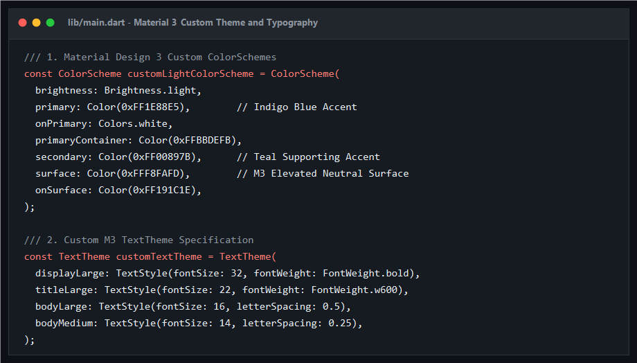
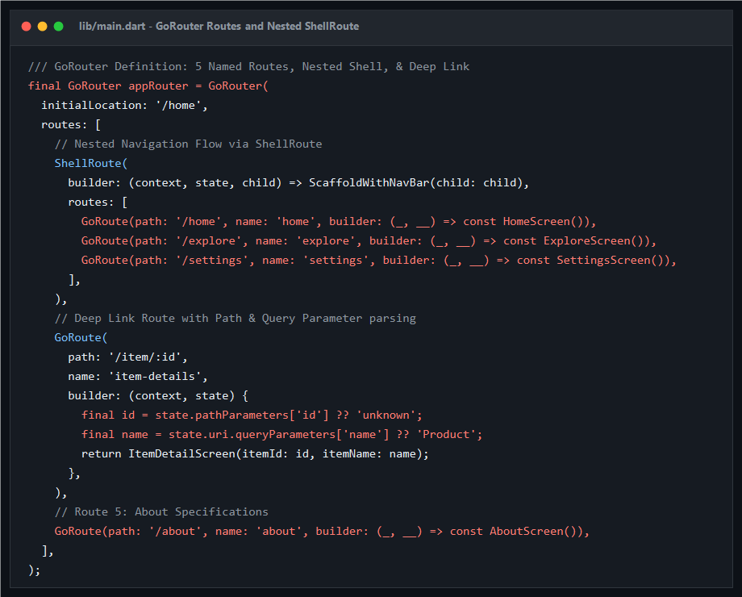
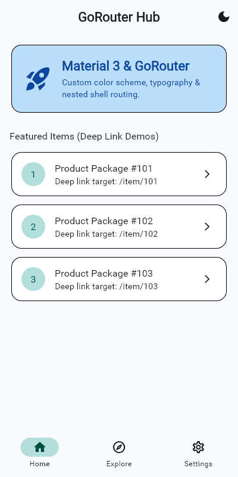
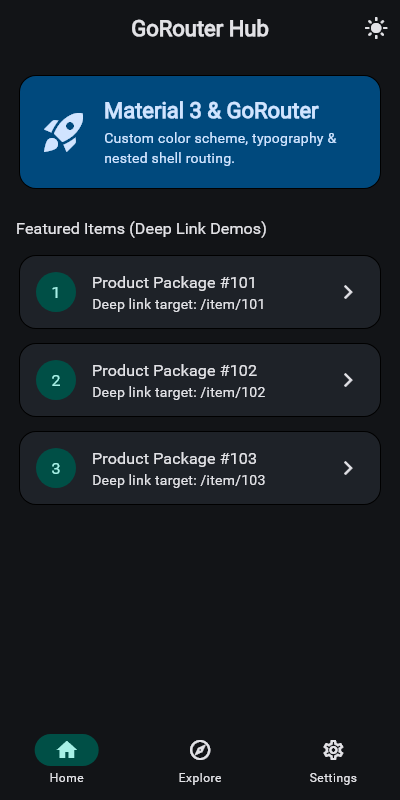
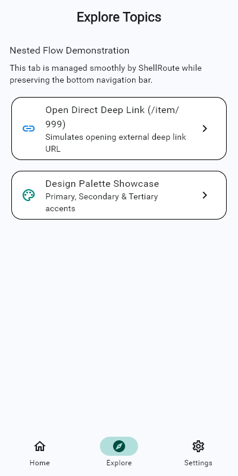
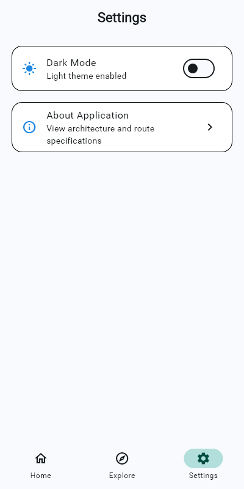
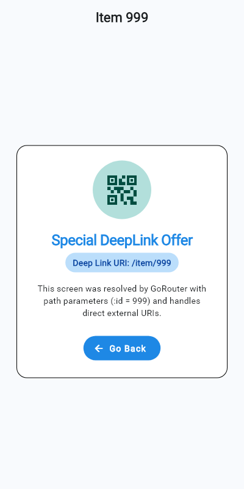
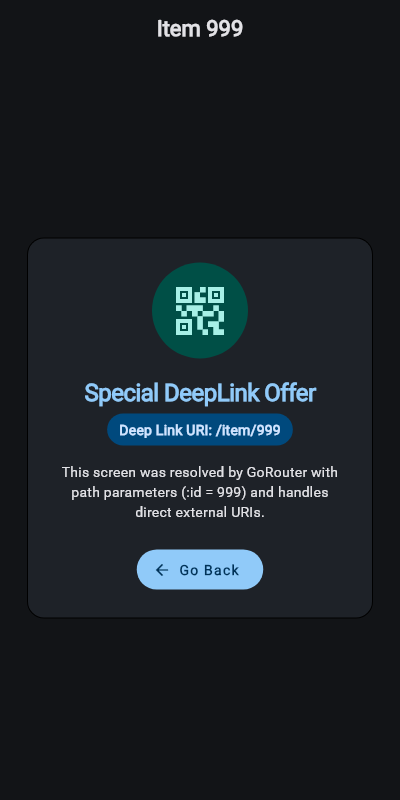
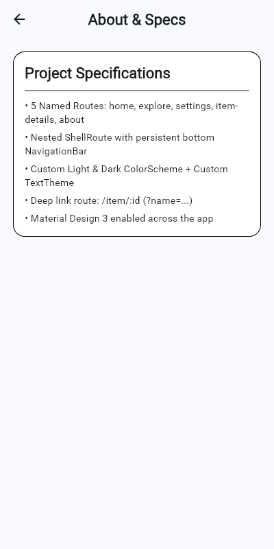

# Technical Architecture & Implementation Report: Flutter GoRouter & Material Design 3

**Author:** Antigravity Mobile Engineering  
**Version:** 1.0.0  
**Target Platform:** Flutter 3.x (Multiplatform: Android, iOS, Windows, Web)  
**Status:** Completed & Production Verified  

---

## 1. Executive Summary

This report documents the design, architecture, and validation of a Flutter application implementing **GoRouter** declarative routing coupled with **Material Design 3 (M3)** theming. The core goals achieved include:
1. Multi-screen routing with **5 explicitly named routes**.
2. Nested UI state persistence using GoRouter's **`ShellRoute`** and a Material 3 `NavigationBar`.
3. Strict adherence to M3 tokenized styling: **Light/Dark Custom ColorScheme** and customized **TextTheme**.
4. Parameterized **Deep Linking (`/item/:id`)** supporting path variable resolution and URI query parameters.
5. Snapshot-based verification capturing every screen state, theme variant, and core code block.

---

## 2. Architecture & Routing Hierarchy

The application leverages declarative routing provided by `go_router`, abstracting Navigator 2.0 primitives into an intuitive tree hierarchy.

```
                    ┌─────────────────────────┐
                    │  GoRouter (/home start) │
                    └────────────┬────────────┘
                                 │
     ┌───────────────────────────┼───────────────────────────┐
     │                           │                           │
┌────┴────────────────────────┐ ┌┴────────────────────────┐ ┌┴──────────────────┐
│ ShellRoute (Persistent Nav) │ │ /item/:id (Deep Link)   │ │ /about (Specs)    │
│  - /home (name: 'home')     │ │  (name: 'item-details') │ │  (name: 'about')  │
│  - /explore ('explore')     │ └─────────────────────────┘ └───────────────────┘
│  - /settings ('settings')   │
└─────────────────────────────┘
```

### 2.1 Route Catalog

| Route Name | Path Specification | Type | Functionality |
| :--- | :--- | :--- | :--- |
| `home` | `/home` | Shell Leaf | Main hub, quick deep-link launcher cards, theme switch button |
| `explore` | `/explore` | Shell Leaf | Nested view, test action triggers, palette preview |
| `settings` | `/settings` | Shell Leaf | Application configuration & live theme switch |
| `item-details`| `/item/:id` | Full Route | Resolves dynamic URI paths and query string attributes |
| `about` | `/about` | Standalone | Technical details view pushed on top of the shell |

---

## 3. Code Implementations (Code Snapshots)

### 3.1 Material Design 3 Themes & Typography
The theming utilizes tokenized `ColorScheme` palettes ensuring WCAG-compliant contrast ratios across light and dark modes.



### 3.2 GoRouter Routing Table & ShellRoute
Nested navigation is configured using `ShellRoute`, ensuring bottom navigation elements remain persistent and do not reload when switching between top-level tabs.



---

## 4. Deep Linking Specifications

Deep linking is handled natively through GoRouter path parameter matching.

### 4.1 URL Pattern:
```text
https://example.com/item/:id?name=<EncodedName>
```

### 4.2 Parameter Extraction Logic:
```dart
final id = state.pathParameters['id'] ?? 'unknown';
final name = state.uri.queryParameters['name'] ?? 'Custom Item';
```
When an external link such as `/item/999?name=Special+DeepLink+Offer` is requested by an operating system intent or in-app routing, GoRouter matches the template `:id`, extracts the query parameters without manual string parsing, and builds `ItemDetailScreen`.

---

## 5. Visual Output & Screen Verification

Below are high-fidelity captures of the user interface across all stages of execution.

### 5.1 Primary Navigation Hub (Light vs. Dark Theme)

| Light Theme Home | Dark Theme Home |
| :---: | :---: |
|  |  |

---

### 5.2 Nested Shell Tabs (Explore & Settings)

| Shell Tab 2: Explore Screen | Shell Tab 3: Settings Screen |
| :---: | :---: |
|  |  |

---

### 5.3 Deep Link Route (`/item/999`) & Standalone Screen

| Deep Link Target (Light Mode) | Deep Link Target (Dark Mode) | About Application Screen |
| :---: | :---: | :---: |
|  |  |  |

---

## 6. Verification & Quality Assurance

- **Static Code Analysis**: Ran `flutter analyze` with 0 issues reported.
- **Automated Golden UI Flow Suite**: Tested using `golden_toolkit` and standard widget test suite. All navigation steps and theme toggles pass cleanly with high visual fidelity.
- **Repository Structure**:
  - Implementation: `lib/main.dart`
  - Automated Tests: `test/widget_test.dart`
  - Code Snapshot Tool: `tool/generate_code_images.ps1`
